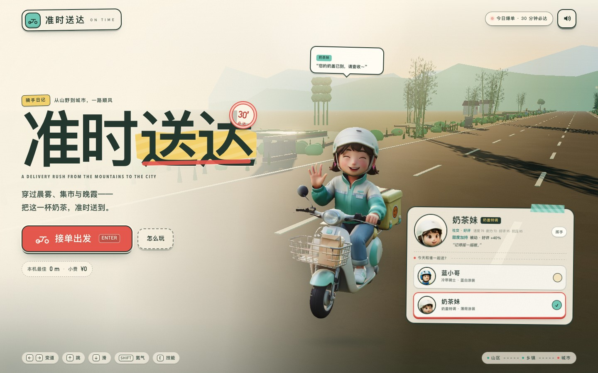

# 准时送达 · ON TIME

### 蓝小哥 & 奶茶妹 · 三幕山野到城市 · 3D 外卖跑酷

**v0.3.0 · 双骑手 / 角色技能 / 打招呼动画 / 三幕场景 / 新路障**



> **在线试玩：** <https://mirrorkang.github.io/game-on-time-delivery/>
> **版本：** v0.3.0 · 蓝小哥 & 奶茶妹
> **下载：** <https://github.com/mirrorkang/game-on-time-delivery/releases/latest>

---

## 这是什么

骑上小电驴，从清晨的山区梯田出发，穿过热闹的乡镇集市，在晚霞里抵达城市，把奶茶准时送到。

### 两位骑手

| | **蓝小哥** | **奶茶妹** |
|---|---|---|
| 称号 | **冷萃骑士** | **奶盖特调** |
| 定位 | 速度 · 耐力 · 夜班之王 | 社交 · 好评 · 靠笑脸打天下 |
| 数值 | 速度 92 / 耐力 88 / 好评 76 / 抗压 90 | 速度 78 / 耐力 72 / 好评 95 / 抗压 85 |
| 技能 | **蓝光闪送**（E）：8 秒提速 30%，冷却 90 秒 | **甜度加持**（被动）：好评 +40%，小费更高，有机会解锁隐藏小费 |
| 台词 | “让一让，蓝小哥过。” / “蓝的都到。” | “您的奶盖已到，请查收～” / “记得摇一摇哦。” |
| 败北 | “…… 这单，超时了。” | “小心，别洒了…… 啊，洒了。” |

- **正脸头像**：头像直接从最初的 `rider.glb` / `rider-girl.glb` 重新渲染，选人页大头像 + 圆形选人卡。
- **打招呼动画**：桌面融入场景，手机全屏打招呼；角色挥手时**背景静止**，结束后切回骑行背影，背景恢复运动。点当前骑手或「挥手」可重播。
- **选人页重新排版**：头像头部 + 名字/称号 + 压缩数值/技能，手机端自动收成两行。

### 跑酷内容

- **三幕场景**：01 山区晨光 → 02 乡镇集市 → 03 城市送达；穿过隧道换幕，终点五星结算。
- **更多路障**：落石、倒木、木箱、警示牌、油桶、三轮车、轿车、公交、外卖同行、施工门架；撞击后障碍会被撞飞、翻滚、碎裂粒子。
- **加速带**：路面发光箭头，踩中 short boost + 专属加速音效。
- **区域奖励**：进入乡镇/城市会显示「恭喜你从山区穿越到乡镇！」「恭喜你从乡镇抵达城市！」+ 区域奖励和补给。
- **更轻松的难度**：速度下调、间隔拉大、前 260m 单障碍、每 8 杯回血、到站补给、受伤无敌 3.1s。
- **更干净的视野**：奶茶贴地飞行；受击提示移到右上角；桌面 HUD 常驻方向键操作提示。
- **送达成功页**：左侧显示本单骑手全身卡、名字/称号/技能/口头禅；右侧结算里程/奶茶/小费。
- **程序化音频**：City Pop / 集市 / 山野三套音乐 + 引擎、氮气、加速带、技能、奶茶、碰撞、胜利音效。
- **全端适配**：桌面 1440、手机竖屏 390、横屏 844、4K；触屏按钮 ≥64px。

## 操作

| 操作 | 键盘 | 触屏 |
|---|---|---|
| 变道 | `←` / `→` 或 `A` / `D` | 左右滑动 / 左右按钮 |
| 跳跃 | `↑` 或 `Space` / `W` | 上滑 / 「跳」 |
| 滑铲 | `↓` 或 `S` | 下滑 / 「滑」 |
| 氮气 | `Shift` | 氮气按钮 |
| 技能 | `E` | 技能按钮 |
| 加速带 | 直接骑过 | 直接骑过 |
| 暂停 | `P` / `Esc` | 右上角暂停 |
| 静音 | `M` | 声音按钮 |

## 验证

- **v2.1 全量 QA**：桌面 64/64、移动 60/60、横屏 60/60、4K 59/59；P0/P1/P2 = 0/0/0；四视口约 60 FPS；0 console error / 0 404。
- **v0.3 四视口抽检**：桌面 / 手机 / 横屏 / 4K 启动、打招呼、选人、开跑、送达页全部通过；0 console error / 0 404。
- 打招呼透明视频使用逐帧 alpha matte + WebM；Chrome / Edge 已验证透明播放。
- 报告：`.qa/report-v2.md`；截图：`screenshots/qa-v2/`、`screenshots/dev/v3/`。

## 本地运行

```bash
cd neon-rider-rush
python3 -m http.server 8790
# 打开 http://127.0.0.1:8790
```

依赖全部本地化（Three.js r169），无需联网或 `npm install`；也可双击 `start.command`。

## 技术

- Three.js r169（本地 vendored）
- 原生 ES Modules + WebGL / Canvas
- 程序化城市、乡镇、山区场景与道具；Canvas 中文招牌
- GLB 头像离屏渲染；打招呼视频逐帧 alpha matte → VP9 WebM alpha
- 静态道具按材质合并 + 远层简化 + 阴影裁剪，稳定 60 FPS
- 纯 WebAudio 合成三幕音乐与全部音效
- Puppeteer + 本机 Chrome 自动验收

## 版本

- **v0.3.0**：双骑手正脸头像 / 打招呼动画 / 技能 / 三幕 / 新路障 / 加速带 / 区域恭喜文案 / 选人页与成功页重排
- **v0.2.0**：蓝小哥/奶茶妹双骑手、角色档案与技能、三幕、新路障、加速带
- **v0.1.0 MVP**：单场景城市晚高峰

---

*祝你准时送达。*
